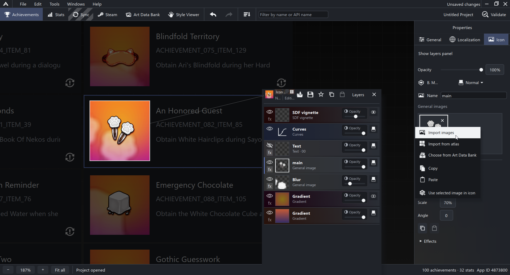
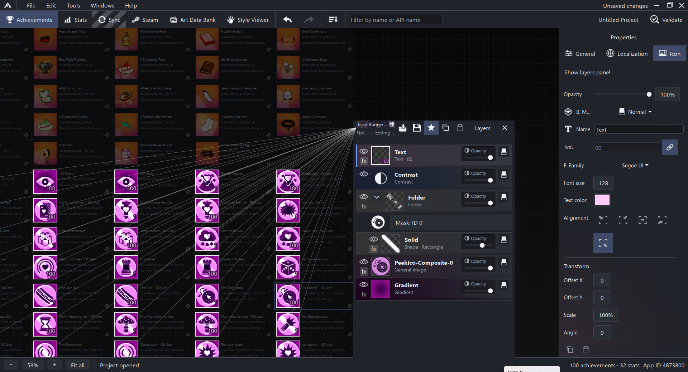
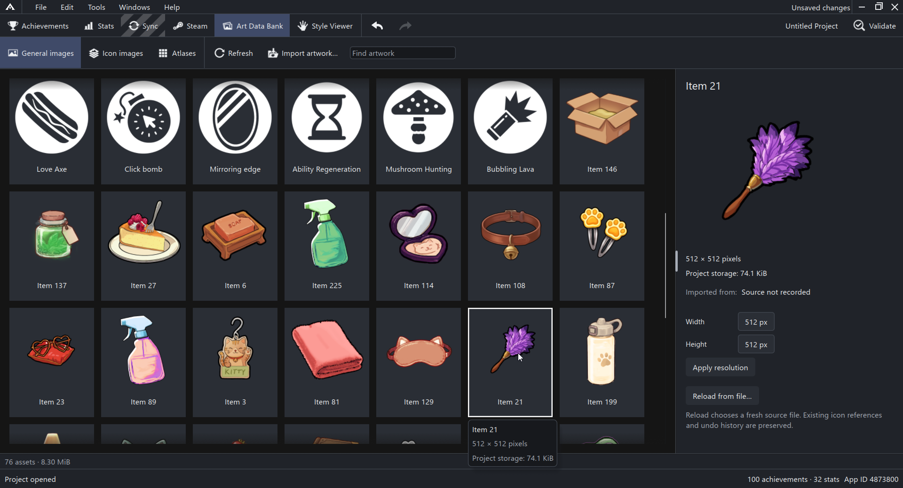
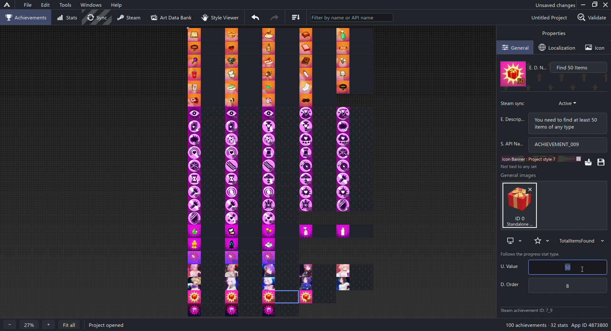

# Achimeld

**Create, organize and style your game's achievements, then bring them into Steam Partner.**

Achimeld is a Windows desktop app for game developers. Keep achievement names,
descriptions, translations, stats and icon artwork together in a local project,
with a visual workspace for designing the whole collection. Review changes and
synchronize with Steam Partner as your game evolves.

[Website](https://achimeld.com/) · [Get Achimeld](https://achimeld.com/#packages) · [Discord](https://discord.gg/bRSXsjZmU) · [Build from source](#for-developers)

## What you can do

- **Plan your achievements visually.** Arrange achievement cards on a zoomable
  canvas, edit their details, manage stats and set progress thresholds.
- **Create a consistent set of icons.** Combine artwork, text, gradients, shapes,
  masks and effects in layers. Reuse styles across achievements and preview the
  results together.
- **Keep artwork organized.** Import images and atlases into the Art Data Bank,
  reuse them in icons, and keep project artwork alongside your saved project.
- **Manage names and translations.** Edit localized achievement text and use
  unlock-value placeholders for milestones such as “Find 50 items”.
- **Review changes before syncing.** Compare your project with Steam Partner,
  choose which changes to send or bring back, and review the differences. Final
  publication is performed in Steamworks.
- **Connect your development tools.** The built-in [MCP server](docs/mcp-server.md)
  lets compatible AI assistants work with achievements, stats, translations and
  icon styles in the open editor.

## Get Achimeld

The source code is free and open source under the [Apache 2.0 license](LICENSE).
The supporter package provides the same creative tools with a convenient Windows
installer and helps fund development.

| Option | What you get | How to get it |
| --- | --- | --- |
| **Free — build it yourself** | Source code and build tools. You compile the application on Windows. | Clone or download this repository, then follow the [build guide below](#for-developers). |
| **$5 supporter package — coming soon** | A ready-made Windows installer, with the same core toolkit. | Visit [achimeld.com](https://achimeld.com/#packages) for installer availability and the purchase link when checkout opens. |

**The supporter checkout is not live yet.** The website currently shows the
installer as coming soon. GitHub releases contain source code; installers are not
hosted on GitHub or GitLab.

## Screenshots

### Design achievement icons in layers

Combine your game's artwork with gradients, text and effects, and see the result
on the achievement card while you edit.



### Keep a whole collection visually consistent

Work with shared icon styles across multiple achievements, including text and
milestone values.



### Keep your artwork in one place

Browse imported images and atlases in the Art Data Bank, inspect artwork, and
reuse it throughout the project.



### See the bigger picture

Zoom out to organize the full achievement collection, then select an achievement
to edit its name, description, linked stat and unlock value.



## For developers

Achimeld is built with Rust and locally maintained C# libraries. This repository
contains the public application source, artwork and build inputs. Internal
publishing tools stay in the development repository's `private/` folder.

The app is under active development. See the [roadmap](ROADMAP.md),
[implementation status](docs/rewrite-status.md), [desktop feature status](docs/desktop-rewrite.md)
and [security documentation](docs/security/README.md) for current feature support
and known limitations.

Steam Partner access requires permission to manage your game's Steamworks app.
Sign in through Achimeld's dedicated browser window; the editor does not ask for
your Steam password. Achimeld is not affiliated with or endorsed by Valve.

<details>
<summary><strong>Build, run and inspect Achimeld from source</strong></summary>

### Source layout and implementation details

- Rust package verifier, broker, Windows filtering policy, process Jobs and authenticated supervision: `crates/achimeld-bootstrapper`.
- Native Rust desktop, local commands, undo, layered imaging and presentation: `crates/achimeld-app`, `crates/achimeld-application`, `crates/achimeld-ui`, `crates/achimeld-imaging` and `crates/achimeld-persistence`.
- Offline inspector and typed read client: `crates/achimeld-app`, `crates/achimeld-browser` and `crates/achimeld-security`.
- Constrained receiving policy and dispatch: `bridge/read-worker`.
- Application-owned Playwright driver, portal normalization, sanitization and parsing: `bridge/Achimeld.Browser`.
- Managed supervision, network/profile policy and wire protocol: `bridge/Achimeld.Security`. Domain/hash compatibility implementation: `bridge/Achimeld.Core`.

No application library is taken from an installed package. The worker and all three managed libraries are compiled from source here. Third-party dependencies use committed NuGet lockfiles; Chromium uses `build/browser-runtime.lock.json` with an exact archive URL and SHA-256. No browser profile or credentials are build inputs.

Achievement display names and descriptions support `{0}` as the achievement's unlock value in every language. For example, `Find {0} sticks` with an unlock value of `5` displays and synchronizes as `Find 5 sticks`. The localization editor previews the result and saves the original template, so changing the value updates the text automatically. Without an unlock value, the token stays visible.

The Sync tab compares a fresh Steam read with the saved project. Choose uploads or imports per entry, review field differences, then apply the selection. Uploads include definition/text changes and paired achievement icons; imported artwork is retained in the Art Data Bank. Draft changes are read back before project/catalog baselines are saved. Interrupted runs require a fresh review. Publish manually in Steamworks. Live account-dependent acceptance for the new synchronization adapter remains unqualified.

The desktop rewrite is in progress. Local editing, undo, colors, layered previews, reviewed draft synchronization and paired project/catalog saves are implemented; the [desktop parity ledger](docs/desktop-rewrite.md) records remaining features. The [local editor MCP server](docs/mcp-server.md) exposes the open editor through `Achimeld.exe --mcp`, including guarded edits, owned artwork, styles, icon exports and shared history. Remote deletion and official release trust remain pending. Existing project-file format identifiers remain supported for data compatibility; they are not project dependencies.

## Build and audit

Use Windows x64, Rust 1.99.0 MSVC, Visual C++/Windows SDK, .NET 10 and PowerShell 7. Build outputs stay outside this source repository. `C:\Projects\AchimeldBuild\current\package` contains the latest verified package; every successful package is copied to `C:\Projects\AchimeldBuild\DD_MM_YYYY\build-TIME-ID` (for example `15_10_2026`). Multiple builds on one day retain separate copies. Rust and .NET intermediates and audit evidence live under `current`; reusable tools, downloads and dependencies live under `cache`. Set `ACHIMELD_BUILD_ROOT` to override the external root when using the PowerShell entry points or .NET; direct Cargo uses the default external `current\target` path. Source PNG/ICO/raw pixel artwork remains in the repository and is embedded in the compiled executables. First provision managed packages online:

```powershell
dotnet restore bridge/read-worker/ReadWorker.csproj --locked-mode --packages C:/Projects/AchimeldBuild/cache/nuget
./build/Audit.ps1 -Offline -Fixtures
./build/BridgePackage.ps1 -Development
```

The first package build downloads the pinned Chromium archive. Subsequent builds can use `-Offline` with cached NuGet packages and the verified browser archive. Offline mode skips dependency advisory fetching; dependency identity and freshness are different claims. `-DependencyAudit` selects the separately provisioned RustSec gate.

Audit includes full workspace lint/tests, real Windows pipe/process fixtures, the receiving and managed browser/security policies, synthetic Chromium request fixtures, local source dependency checks, unchanged compatibility vectors, and local worker publication. Chromium fixtures use synthetic pages and a rejecting local proxy; they need the cached pinned browser archive for offline runs. Provision it with an initial online development package build before the first offline fixture audit. Exact source and log identities are recorded in a fresh `C:\Projects\AchimeldBuild\current\audit-*/evidence.json`. Installed enforcement and live Steam acceptance remain separate.

The development builder publishes the local worker and libraries, provisions the pinned browser, archives exact local source, rebuilds Rust executables with a fresh public development key, signs the complete inventory with an ephemeral in-memory private key, and verifies it. `Achimeld.NodeHost.exe` permits only the packaged Playwright driver command and packaged Node with explicit stdio inheritance.

## Steam reads and optional protected installation

The verified package runs directly as the current user, including Steam sign-in and configuration reads. No installation or administrator approval is required:

```powershell
./build/Read-Steam.ps1 -PackagePath C:/Projects/AchimeldBuild/current/package -AppId YOUR-APP-ID
C:/Projects/AchimeldBuild/current/package/Achimeld.exe --user-self-test
```

The development-only user self-test exercises authenticated supervision and the real worker handshake/stop without opening a browser or contacting Steam. User sessions retain package signature/inventory verification and replacement locks, process Jobs, authenticated IPC, the attributed destination-limited proxy, and browser request rules. They do not enforce Windows socket denial or require administrator-owned package ACLs. A compromised process can bypass application request/proxy settings; this is not an OS network sandbox.

For optional Windows network isolation, retain the verifier digest printed by the trusted build independently and install with administrator approval. Run acceptance and reads as a normal user afterward:

```powershell
./installer/Install-Development.ps1 -PackagePath PACKAGE -ExpectedVerifierSha256 TRUSTED-BUILD-DIGEST
./tests/acceptance/Test-InstalledPackage.ps1 -PackagePath INSTALLED-PACKAGE
./build/Read-Steam.ps1 -PackagePath INSTALLED-PACKAGE -AppId YOUR-APP-ID -Protected
INSTALLED-PACKAGE/Achimeld.exe --protected
```

Run acceptance and reads as a normal user. Sign in manually in the dedicated visible browser if needed; that sign-in persists in `%LOCALAPPDATA%/Achimeld/Browser/ChromeProfile`. Browser requests are restricted to authentication and configuration-read phases, with no return to login authority after reading begins. Read results are bounded, normalized, checked against the requested App ID and saved under `%LOCALAPPDATA%/Achimeld/RustReads`. Driver or request-policy failures terminate the session; no write/replay operations are enabled. Live-site compatibility remains a separate qualification in [known gaps](docs/security/known-gaps.md).

## Build and run the desktop

Double-click `build-and-run.bat` to build a fresh signed development package and launch its Rust desktop as the current user, without administrator approval. The bootstrapper verifies and supervises the package directly in `current\package`. Start the batch file normally. It finds PowerShell 7 on PATH, in standard installation directories, or in the Codex bundled runtime. Its child build tools use that same PowerShell.

Every build-and-run invocation (including `--build-only` and the desktop build shortcut) deletes obsolete worker fixtures, temporary package folders and signing inputs only after the new package passes verification. Rust/.NET outputs are retained for incremental builds, along with the current runnable package, dated archives, dependency/toolchain cache and audit evidence. Failed builds retain their temporary outputs for diagnosis until a later successful build. Running the current package without rebuilding does not clean artifacts. Cleanup stops on locked files or directory links. Compiler output and elapsed-time updates remain visible during packaging.

After a successful build and archive verification, `achimeld.lnk` on your desktop points directly to `C:\Projects\AchimeldBuild\current\package\Achimeld.exe`. It follows the current verified package without rebuilding or installing. The desktop build-and-run shortcut points directly to the authoritative `C:\Projects\Achimeld\achimeld\build-and-run.bat` in this source repository. This builds into `C:\Projects\AchimeldBuild\current` by default. It survives deletion of the entire `current` directory and rebuilds it before archiving and launching. The permanent `build-and-run.bat` is in the repository root. Build-only runs refresh both shortcuts.

### What can I delete?

Close Achimeld and wait for builds/audits to finish before deleting generated storage.

| Location | Keep or delete? | Effect |
| --- | --- | --- |
| `C:\Projects\Achimeld\achimeld` | Keep: source, artwork, build scripts and permanent `build-and-run.bat` | Required to rebuild; this is not build output. |
| `C:\Projects\AchimeldBuild\cache` | Keep for offline rebuilding | Contains reusable toolchains, SDK libraries and dependencies. Removing it requires provisioning those again. |
| `C:\Projects\AchimeldBuild\current` | Disposable generated output | Can delete the whole folder. The normal run shortcut stops working until rebuilt; the build-and-run shortcut still works. A clean rebuild takes longer. Audit logs/evidence here are also lost. |
| `C:\Projects\AchimeldBuild\DD_MM_YYYY` | Disposable saved packages | Delete dates you no longer need; those historical packages are lost. |

To recover after deleting `current`, use the desktop **achimeld build and run** shortcut or double-click `C:\Projects\Achimeld\achimeld\build-and-run.bat`. Generated launcher copies inside `current` are disposable too; they are not the permanent build entry point. Keep projects and their sibling `.art-data-bank` folders outside these disposable output folders.

Successful builds refresh three desktop shortcuts: **achimeld build and run** builds and launches, **achimeld** runs the current verified app without rebuilding, and **achimeld build guide** opens this repository README.

Build and Run is only for local testing. It launches `C:\Projects\AchimeldBuild\current\package\Achimeld.exe`, prints that path before launch, and never installs, uninstalls or writes application files in Program Files. The batch file and generated launchers reject the former protected-install option. Ready builds use the separate installer; see the private publishing guide. Existing installed copies remain independent of local test builds.

Build storage is normal-user data: deleting outputs, caches or dated archives does not require administrator approval. Launchers use working directories outside build storage. Close older app/launcher windows before deleting a directory they still have open; elevation does not resolve an in-use directory. Administrator approval is reserved for the separate installer and its machine-wide network policy.

```bat
build-and-run.bat --offline
build-and-run.bat --offline --build-only
```

`--offline` requires cached dependencies and the verified browser archive. `--build-only` builds, verifies, archives and updates the current-build shortcut without installing or launching. The batch file requires the development tools listed above. A double-click run keeps the console open after exit to show diagnostics. Use `--help` for usage. Direct launch of `achimeld-app.exe` is rejected because mandatory supervision is part of the application contract.

## Offline inspection and compatibility

```powershell
./build/Rust.ps1 -CargoArguments @('build','--workspace','--locked')
C:/Projects/AchimeldBuild/current/target/debug/achimeld-inspect.exe snapshot ./tests/fixtures/steamworks/normalized-2026-09.html 480
C:/Projects/AchimeldBuild/current/target/debug/achimeld-inspect.exe project C:/path/to/project.achv
./build/Test-Migration.ps1
```

The inspector does not launch a browser. The compatibility oracle uses local domain, parser and wire source. `build/RecordBaseline.ps1` records their current source hashes; changed vectors require deliberate review. Ordinary Rust tests consume committed vectors.

</details>

## License

Achimeld is licensed under the [Apache License, Version 2.0](LICENSE). Third-party components retain their own licenses and notices. The license does not grant permission to use trademarks.
