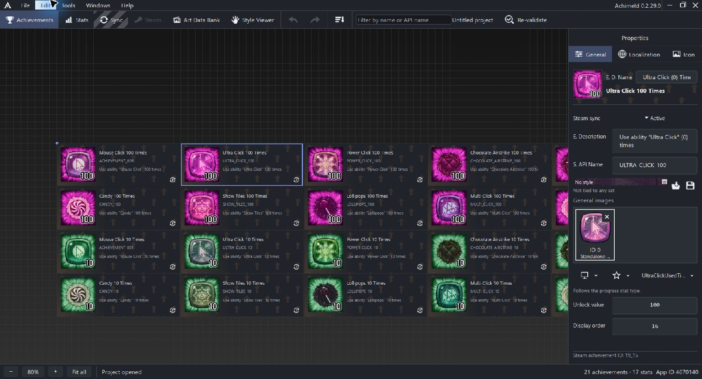
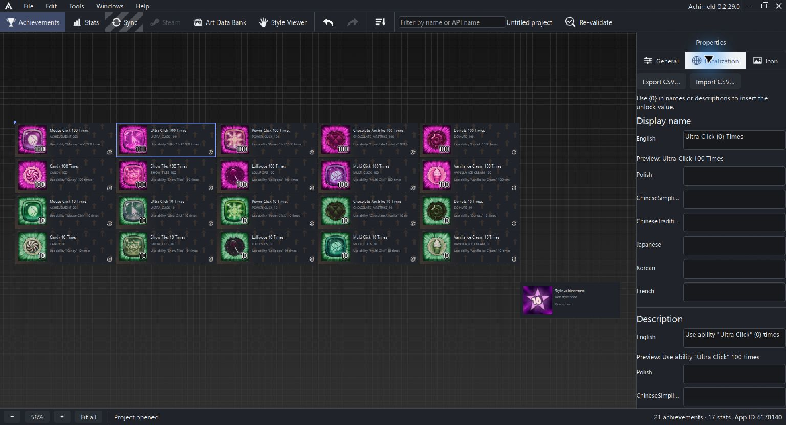

# Achievement General settings

Select an ordinary achievement on the Achievements canvas, then open General in Properties. This is where you set its identity, English text, unlock configuration, artwork inputs and Steam participation.

Labels may be abbreviated in a narrow inspector. Hover a label to read its complete name.

## Identity and text

**English display name** is the player-facing name. **English description** explains the achievement. **Steam API name** is the identifier used by the game and Steam configuration. Changing one does not mean the others should have the same wording.

For a Steam-linked achievement, review any rename guidance shown alongside the API name before changing its identity.

The Steam achievement ID at the bottom comes from the saved remote information. It is separate from your editable API name and from the achievement's internal project identity.

## Use the unlock value in text

Write `{0}` in a name or description to insert the achievement's unlock value. With a value of 100:

| Saved template | Resolved text |
| --- | --- |
| Ultra Click {0} Times | Ultra Click 100 Times |
| Use ability "Ultra Click" {0} times | Use ability "Ultra Click" 100 times |

Keep the template when you want the wording to follow the value. The Localization tab also previews the resolved text while retaining the original template. Without an unlock value, the placeholder remains visible.

## Unlock configuration and stat links

The unlock controls let you choose who sets the achievement and whether it follows a progress stat. The authority choices are game client, game server and official game server.

When the achievement is tied to a stat, choose the progress stat and set the unlock value. The numeric kind follows the linked stat: Int uses an integer value; the other stat types use floating-point values.

An achievement without a stat link has its own integer or float unlock-value kind. The unlock value can still supply text templates and value-linked icon text. Defining it in Achimeld does not by itself implement game code that reports progress or unlocks achievements.

The example uses the Int stat `UltraClickUsedTimes` and an unlock value of 100.

## Steam participation

| Status | Meaning in the editor |
| --- | --- |
| Active | Participates in synchronization |
| Unsynced | Ready to synchronize |
| Retired | Remains in the project and is excluded from synchronization |

Retiring a local entry is distinct from deleting a remote achievement.

**Display order** is a stored ordering value. Moving a card on the canvas and changing its display order are separate actions.

The source also retains a conditional Hidden control for achievements already marked hidden. Its availability needs to be explained alongside the relevant creation and import workflows in the full reference.

## Artwork inputs and style

The style banner identifies a matching or selected style, or shows No style. An icon can contain a complete layered composition even when the banner says No style.

The General Images area supplies artwork inputs for the recipe. It does not describe the full stack of decorative layers. See [General Images](general-images.md) and [Icon editor concepts](icon-editor.md).

Click the icon thumbnail or open the Icon tab to inspect the recipe.

