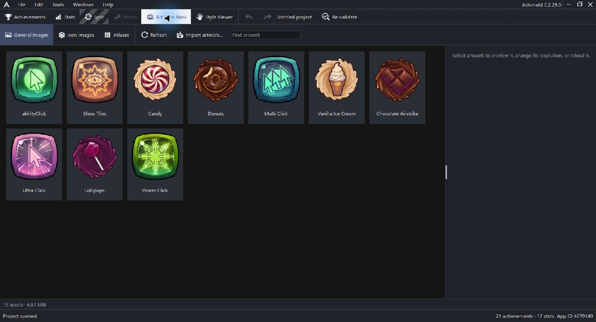

# Art Data Bank

The Art Data Bank manages project-owned artwork. Imported files are retained as owned copies, so the project does not depend only on the original import location.

Open the main Art Data Bank view.

## Tabs and search

| Tab or action | Use |
| --- | --- |
| General images | Artwork attached through achievement General settings |
| Icon images | Other image sources used by icon compositions |
| Atlases | Larger images divided into tiles |
| Find artwork | Filter bank entries |
| Import artwork / Import atlas | Add an owned source |
| Refresh | Refresh the bank's view/details |

Select an asset to inspect its preview, name, storage details, import origin and usage information where available.

## Resolution and reloading

Width, Height and Apply resolution resize the project asset. Reload from file replaces it from a chosen file. Identity is preserved through these source changes, and older versions are retained for undo.

Resizing an atlas changes its tile grid. Check tile width/height, offsets, spacing and traversal in Project settings, then inspect every referenced tile.

Changing an asset shared by several achievements can affect all of those references. Review usage before replacing it.

## Atlas tile selection

An atlas tile is identified by atlas plus tile index. Tile dimensions, left/top offsets and horizontal/vertical spacing define the grid. Row-major and column-major traversal count tiles differently.

Use Pick atlas tile rather than guessing an index when the source has padding or unusual traversal.

## Import by drag and drop

Dropping images onto empty achievement canvas creates achievements near the drop location. Dropping onto existing artwork retains a General Images/Icon layers destination choice. Layer imports and General Image imports have different composition scopes.

See [General Images](general-images.md) for slot-based inputs. A direct Image layer chooses a bank asset independently of those slots.

## Duplicate delete and repair

Asset context actions include duplication and deletion. Read the usage and confirmation information before deleting a shared source. An asset entry and its achievement references are different objects.

Unavailable artwork remains visible and repairable. Reload the intended source, then inspect its usage and rendered icons. Other available layers can still render while one source is missing.

Keep the sibling Art Data Bank folder with the saved project and localization companion when moving or backing up your work.

