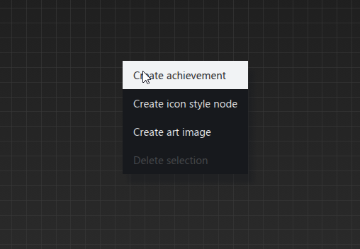
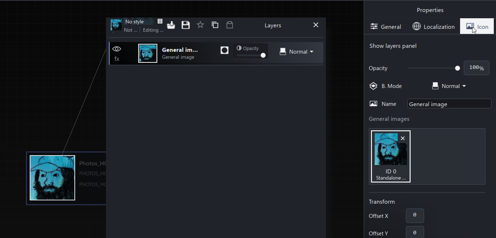
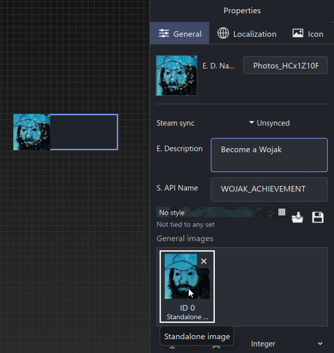
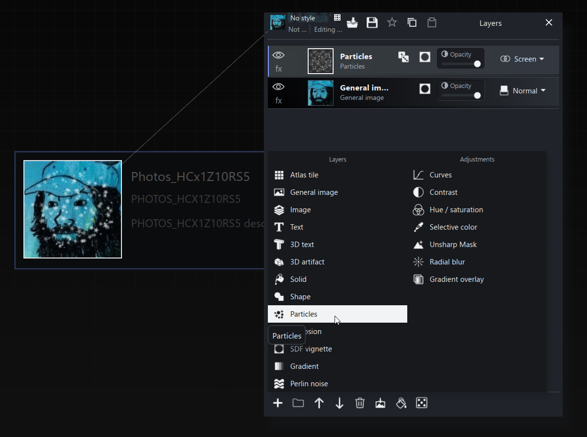

# Create your first achievement and icon

Create an achievement with the Create achievement action, or drag an image onto the achievement canvas to start from your artwork. Build one achievement before designing a whole set. This walkthrough uses the same inputs as the Ultra Click example, so you can compare its General settings and layer stack with your result.

Use a new tutorial project or a separate copy of your own project.

## 1 Start a project

Choose File > New project. Open File > Project settings and give it a recognizable name. Set the intended Steam App ID when you are ready to associate the project with your game.

You can work on local text and icon design before starting a Steam connection.

## 2 Create the achievement

There are a few ways to create an achievement. Choose the starting point that suits you:

- **Start with a blank achievement:** right-click an empty area of the Achievements canvas and choose **Create achievement** from the context menu.
- **Start with an image:** drag an image file onto empty space in the Achievements canvas. Achimeld creates an achievement from that image and keeps the artwork in the project's Art Data Bank. You can drop several images to create one achievement per image.

Drop onto empty canvas space when creating new achievements. Dropping onto an existing achievement instead offers ways to add its General Images or icon layers.

After dropping an image, select the new achievement and click **Icon** in the **Properties** panel to edit its artwork. The screenshot below shows the Icon tab selected, the imported image in General Images (ID 0), and its General Image layer in the Layers panel.

To set the achievement's details, select the card and click **General** in Properties.

Set the API name to `ULTRA_CLICK_100`, the English display name to `Ultra Click {0} Times`, the description to `Use ability "Ultra Click" {0} times`, and the unlock value to 100.

Keep a unique API name within the project. For an existing Steam-linked entry, follow its rename workflow instead of treating the identifier as ordinary display text.

The name preview should read **Ultra Click 100 Times**.

## 3 Choose how progress is represented

For a simple local design exercise, use an achievement without a progress-stat link.

To follow the example project's stat setup, create an Int stat in Stats with API name `UltraClickUsedTimes`. Return to the achievement and use its unlock configuration to tie it to that stat. Keep the unlock value at 100.

This configures the definition. Your game still needs to report progress or unlock the achievement through its own integration.

## 4 Supply a General Image

Select the achievement and click **General** in the **Properties** panel. Find **General images** below the style banner.

If you created the achievement by dropping an image, that artwork is already available here. Select that input rather than importing it again. If you started with a blank achievement, use the source/import controls to add your artwork. Note its slot ID, starting at 0.

In this screenshot, the artwork occupies **ID 0** and is labeled **Standalone image**. When building the icon, choose that slot in a General Image layer.

An image with transparent space around its subject is useful for a composition with decorative layers behind it. You can also choose an atlas tile.

Read [General Images](general-images.md) if you are unsure how the slot relates to the final icon.

## 5 Build the icon

Select the achievement and click **Icon** in the **Properties** panel. Inspect the Layers panel. If you started by dropping an image, select the General Image layer that was created for you. Otherwise, create a General Image layer and choose the slot containing your artwork. Adjust its position and scale until the subject fits.

Add a background layer such as a gradient. Keep the artwork above the background in the stack.

Add a Text layer and choose its link to the achievement unlock value if you want the number 100 drawn into the image. Position and size it so it remains readable at icon size.

The example includes additional particle, explosion, vignette and gradient-overlay layers. They are optional embellishments; a clear image, background and number are enough for this first composition.

### Add a simple particle overlay

1. Select the achievement and click **Icon** in **Properties**.
2. In **Layers**, click **Create layer** (the plus button) and choose **Particles**.
3. Place the Particles layer above the General Image layer so the particles appear over the artwork.
4. Select the Particles layer to adjust its count, size, colors and placement. Start with a small count so the main image stays readable.
5. For bright sparkles like the screenshot, try **Screen** blending and adjust the layer opacity.

Particles adds a decorative effect to the icon as its own layer. The **fx** menu contains separate effects you can apply to a layer, such as Outline or Shadow. See [Particles](particles.md) for detailed controls.

For a simple next step, try [putting artwork in a folder and masking the folder](masks.md#example-put-artwork-in-a-folder-and-mask-it) to make a star-shaped cutout or badge.

## 6 Save and reopen

Use File > Save and choose a tutorial destination. Keep the project, companion localization catalog and sibling Art Data Bank directory together.

Reopen the project and confirm the name template, unlock value, General Image slot and layer stack are retained.

## 7 Export a first pair

Check output dimensions and unachieved icon settings in Project settings. Choose Tools > Export achievement icons and select an empty output folder.

The desktop export writes PNG pairs named from the API name. For this example, expect:

- `ULTRA_CLICK_100.png`
- `ULTRA_CLICK_100-unachieved.png`

Open both images and check dimensions, readability, framing and the unachieved treatment. The desktop export refuses existing or colliding output names; use a fresh folder for a new export.

Exporting creates local files. Save your project separately, and use the reviewed Sync workflow when you want to work with Steamworks drafts.

