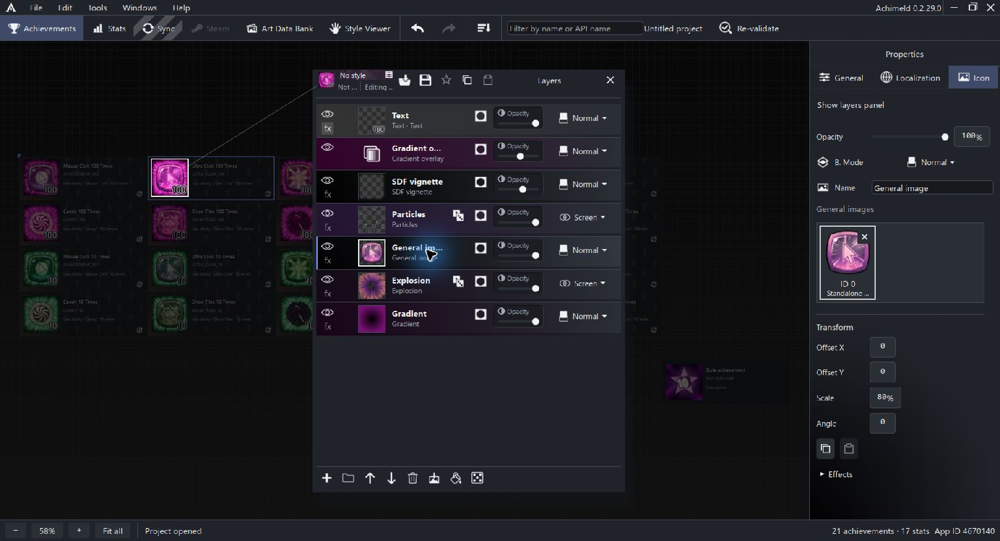
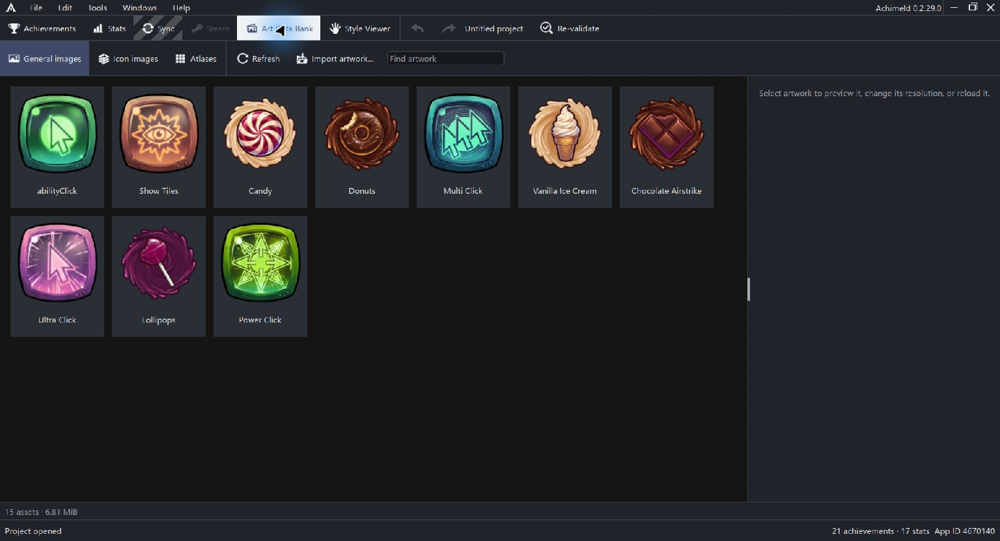

# General Images and icon artwork inputs

General Images are the artwork inputs attached to an achievement. A General Image layer in its icon recipe selects one of those inputs.

This lets the same composition use different artwork for different achievements. The source image and the finished icon remain separate.

Steam achievement imports place the achieved artwork in General image slot 0 and create one General Image layer referencing that slot at full opacity. The artwork remains owned by the Art Data Bank. Reimporting an achievement replaces slot 0 and its imported icon recipe while retaining any other General image slots. The previous image remains in the bank.

## Follow an image from input to output

1. In achievement General settings, find the image in the General Images area.
2. Note its displayed slot ID. The Ultra Click example uses ID 0.
3. Open the Icon tab and select the General Image layer.
4. Check which slot the layer uses, then inspect its transform, opacity, blending and effects.

In the example, the General Image layer uses the purple input image at 80 percent scale. Gradient, explosion, particle, vignette and text layers contribute to the final icon around it.

Changing a source image, changing the layer's transform and changing the entire recipe are three different edits.

## Supported sources

A General Image input can reference a project image or an atlas tile. An atlas is one larger image divided into tiles using its grid configuration.

Use the image explorer and its available import/source actions to choose the input. Artwork imported from a file is retained by the project in the Art Data Bank. The detailed import, clipboard and drag-and-drop workflows belong to the full artwork reference.

Slot IDs reflect positions in the input list. Removing or rearranging inputs requires checking every recipe layer that uses those positions, especially styles that expect more than one image.

## Art Data Bank and direct image layers

The Art Data Bank shows the project's reusable artwork. Its General images, Icon images and Atlases tabs help locate different sources.

A standalone Image or Atlas tile layer can choose artwork directly. A General Image layer instead reads an achievement input slot. Use the latter when a composition should accept different artwork on different achievements.

If artwork is unavailable, inspect and repair its source in the bank. Replacing a missing file and rebuilding a composition are different remedies.

## What to check when an image looks wrong

- Confirm the intended slot contains the correct image or tile.
- Confirm the selected layer is a General Image layer and uses the intended slot.
- Check layer visibility, scale, position, opacity and blend mode.
- Inspect masks and layers above it.
- Check the source in Art Data Bank if it is missing or unavailable.

Changing the icon preview does not export an image or upload it to Steam.

