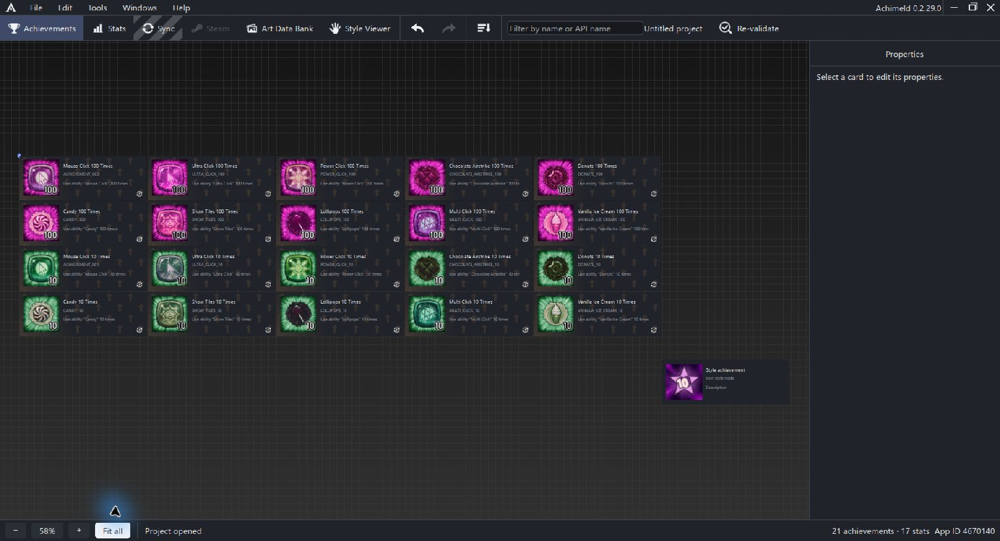

# Getting started with Achimeld

Achimeld brings achievement definitions, stat definitions, icon design and reviewed Steam synchronization into one project. You can build the text and artwork locally, then review how it should match your Steamworks configuration.

Start by understanding three parts of an achievement: its settings describe what it is, its General Images supply reusable artwork, and its icon recipe builds the finished image.

## Find your way around

| View | What you use it for |
| --- | --- |
| Achievements | Organize achievement cards and edit their General settings, localization and icon recipes |
| Stats | Define numeric stats and configure the values achievements can follow |
| Sync | Inspect saved Steam information and prepare the connection and synchronization workflow |
| Steam | Work with Steam information when the current connection and project state make it available |
| Art Data Bank | Manage the project's artwork and atlases |
| Style Viewer | Browse project styles and built-in compositions |

Selecting a card opens its properties. The inspector tabs depend on the selected item: an ordinary achievement has General, Localization and Icon tabs.

Use the filter to find a card by its name or API name. Use the bottom zoom controls and Fit all to frame the canvas. A canvas can include a style helper node as well as ordinary achievements, so its item count need not equal the Steam synchronization count.

## Follow the example

The example project contains an achievement with these inputs:

| Input | Example |
| --- | --- |
| Steam API name | ULTRA_CLICK_100 |
| English display name | Ultra Click {0} Times |
| English description | Use ability "Ultra Click" {0} times |
| Unlock value | 100 |
| Progress stat | UltraClickUsedTimes |
| General Image | The purple Ultra Click image in slot ID 0 |

The name preview reads **Ultra Click 100 Times**. Its icon has a separate Text layer linked to the unlock value, plus a General Image layer and decorative layers.

Read [Your first achievement](first-achievement.md) to build this relationship in your own project. Read [General settings](achievements-general.md) for the individual controls.

## Local work and Steam

Saving a project keeps your local work. Exporting writes icon files for use elsewhere. Synchronization is a separate workflow, and uploads save Steamworks drafts; publishing in Steamworks remains a manual step.

A saved Steam snapshot can remain visible from a previous session. Follow the connection guidance in Sync before treating it as current remote data.

