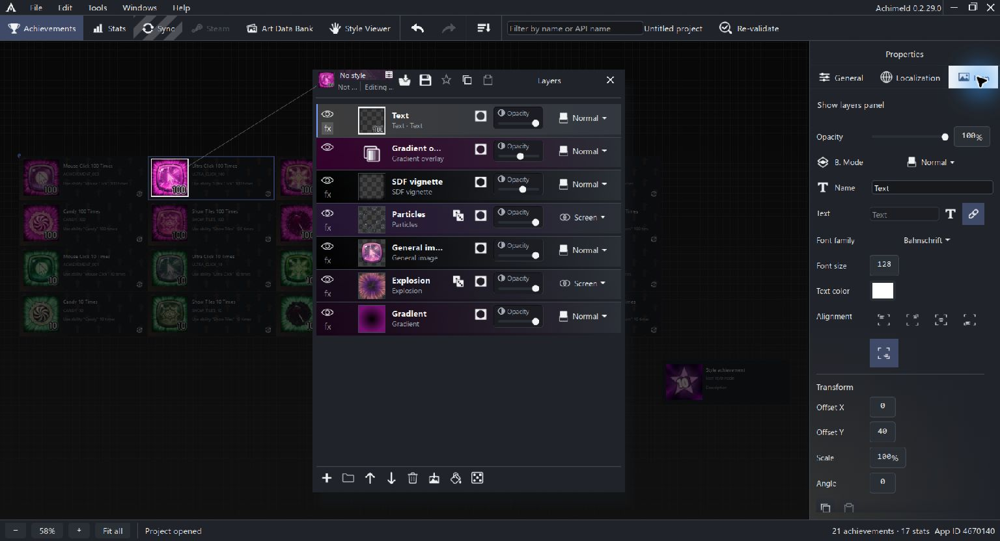

# Icon recipes and reusable styles

An icon recipe is the composition that renders an achievement icon. It combines image sources, decorative layers, adjustments, text, masks and effects.

The selected achievement supplies inputs such as General Images and its unlock value. The recipe determines how those inputs appear.

## Open the recipe

Select an ordinary achievement and open Icon in Properties, or click its icon thumbnail in General settings. The floating Layers panel shows the stack. Depending on Preferences, selected layer properties appear in the right sidebar or alongside the stack.

Use Show layers panel to bring the stack back into view.

On the Achievements canvas, hold Alt to compare each unachieved icon beside its achieved icon. The temporary copies appear over card text when space is tight. Release Alt to hide them; this does not edit or save the project. The Stats canvas does not show this comparison.

## Read the example stack

The Ultra Click composition has these visible layers, from top to bottom:

| Layer | Contribution |
| --- | --- |
| Text | Displays the achievement's unlock value |
| Gradient overlay | Adds a color treatment |
| SDF vignette | Shades the icon |
| Particles | Adds procedural detail |
| General image | Supplies the purple Ultra Click artwork |
| Explosion | Adds a burst behind the artwork |
| Gradient | Supplies the background treatment |

Layer order affects composition. Selecting a layer changes the properties you edit; it does not replace the achievement's General settings.

Each layer has visibility, opacity, blending and a name. Its type determines the additional controls. Image layers can be transformed; text layers have font, color and alignment controls; procedural layers have their own generation parameters.

## Link icon text to the unlock value

The Text layer can use entered text or the achievement unlock value. In the screenshot, the link source is selected and the ordinary text box is disabled.

This is independent of writing `{0}` in the achievement's display name. Use the text template for the achievement wording and the Text layer's link for a number drawn into the icon.

For this example, both resolve from the value 100.

## Masks and effects

A mask controls which parts of a layer or folder remain visible. Effects modify the layer's appearance, such as its outline, shadow or color treatment.

Inspect masks and effects when artwork looks unexpectedly clipped, tinted, blurred or hidden. Try the illustrated [folder and mask example](masks.md#example-put-artwork-in-a-folder-and-mask-it) to shape artwork into a star, then explore the [layer](icon-layers.md), [effect](icon-effects.md) and [mask](masks.md) references.

## Reuse the composition as a style

A style is a reusable recipe. General Image slots and value-linked text allow it to adapt to different achievement inputs.

The project has its own styles, while Style Viewer also exposes built-in collections. Saving a style, importing a style, applying it to an achievement and editing a shared style are separate operations.

Pay attention to Affect style when editing: that mode can update the project style and matching icons together. Use ordinary icon editing when making an individual composition.

No style does not mean an icon has no layers. The Ultra Click example has a complete stack while its banner shows No style.

## Keep the result

Save the project to keep editable composition data and its owned artwork. Use Tools > Export achievement icons to produce image files. Export and Steam synchronization are separate actions.

