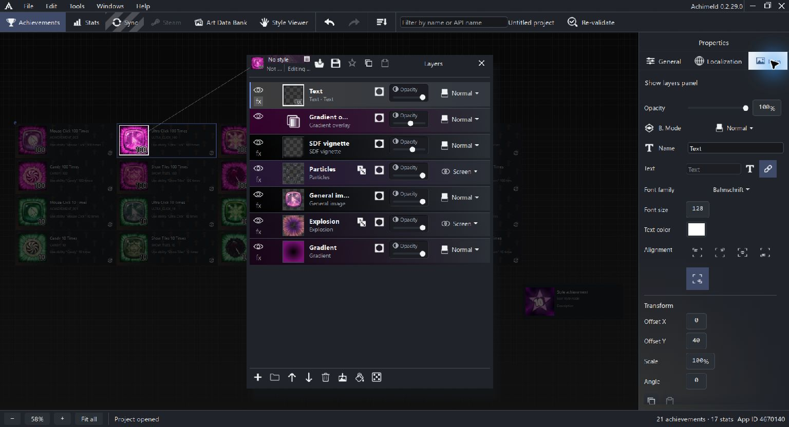

# Icon layer reference

Shape layers have a Shape Explorer and quick load menu. The Explorer starts with an Unsaved changes copy of the current shape. Save preset adds it to the local shape library; Apply to layer changes the shape recipe while keeping the layer identity and other layer properties. The Icon size knob adjusts the list, and preset panels have square corners. Particle composite shapes use the same library workflow in their own category. Rebuilt desktop screenshots and runtime verification are pending.

Use the Create layer button in Layers to add artwork or adjustments. Create folder has its own button. Imported Steam artwork and reference masks belong to special workflows rather than ordinary layer-picker choices.

Select a layer to edit it. See [Icon editor concepts](icon-editor.md) for the stack and [General Images](general-images.md) for achievement inputs.

## Shared controls

Ordinary layers start with opacity, blend mode and name. The eye controls visibility. Drag the row or thumbnail to reorder; dropping onto a folder groups the layer. Right-click for actions such as copying, duplication, grouping and masks.

The blend choices are Normal, Multiply, Screen, Overlay, Darken, Lighten, Add and Difference. Preview a candidate in the menu before selecting it. A blend mode combines a layer with the content below it; its result depends on both images.

For ordinary artwork, Transform offers Offset X/Y from -4096 to 4096, Scale from 1 to 1000 percent, and Angle from -360 to 360 degrees. Copy/Paste transform transfers these settings. Adjustment layers and folders do not expose this ordinary transform row. Explosion uses its own overall scale.

Mask sources have a reduced set of controls; see [Masks](masks.md).

Every layer type has a Show in menu at the bottom of its properties. Choose Both versions (the default), Achieved only, or Unachieved only. A folder's choice applies to its contents. Project settings apply desaturation and the optional gradient map after the unachieved layers are composed.

## Image sources

| Layer | Controls and purpose |
| --- | --- |
| Image | Choose image opens the project artwork picker; Image selects the referenced asset |
| Atlas tile | Pick atlas tile, atlas selection and Tile index (0-20000); Use general image atlas / tile links the source to the achievement's general artwork |
| General image | Selects the achievement's General Image slot; Style Viewer uses Image ID and separate preview inputs |
| Imported Steam artwork | Retains imported artwork in the project and uses image-source controls; investigate its import workflow rather than looking for a separate ordinary Add layer choice |

Use the image transform to place the source within the icon. Missing artwork should be repaired in [Art Data Bank](art-data-bank.md), rather than replaced by a decorative layer.

## Text

**Text** has entered-text/value-link source controls, system font family, Font size (1-512), Text color and alignment. Alignment choices are center and the four corners. The unlock-value source draws the achievement's number; it is independent of the name's `{0}` template.

**3D text** shares text/font/source controls and adds geometry, camera, material, lighting and output masks. See [3D text](text-3d.md).

## Solid and Shape

**Solid** fills the layer with its Fill color. It is useful as a background or mask source.

**Shape** offers Rectangle, Sphere, Polygon and Star, with Fill color, Width, Height, Inner radius, Vertices and Shape angle. Width, Height and Inner radius each expose 0.01-2; Vertices exposes 3-64 and Shape angle -360 to 360 degrees. These are shape controls, separate from the enclosing layer transform. Copy/Paste shape transform transfers shape width, height and angle.

Shape controls can remain visible even when a parameter is relevant mainly to a particular shape. A star's inner radius changes its indentation; vertices determines its point count.

## Gradient and SDF vignette

**Gradient** paints a gradient as artwork. The ordinary editor offers Linear or Radial placement, Angle (-360 to 360 degrees), presets and editable color/opacity stops. Model-level gradient kinds are not a promise that every editor exposes every kind. See [Gradients and color maps](gradients.md).

**SDF vignette** fills the edge region with a Color or Gradient map. Roundness is 0-1, Inset 0-0.95 and Softness 0-1. Invert vignette fills the center instead. Gradient-map stops follow the fade from transparent to full strength; this map does not use a spatial angle. Switching fill retains the other fill's settings.

## Procedural artwork

| Layer | Main controls | Full guide |
| --- | --- | --- |
| Perlin noise | Seed, Noise frequency, Octaves, Detail strength, Frequency spacing, octave switches, Gradient colors | Below |
| Particles | Count/seed, variation ranges, spawn geometry, composite particle shapes and 2D colors | [Particles](particles.md) |
| Explosion | New layers use the bundled boom recipe; object count/seed, shape ranges, construction-to-polar projection, fill, scale, blur and gradient | [Explosions](explosions.md) |
| 3D artifact (existing layers) | Editable primitive parts, transforms, material, camera, lighting and output; new creation is hidden | [3D artifacts](artifacts-3d.md) |

Perlin noise uses Seed 0-2147483647, Noise frequency 0.1-128, Octaves 1-12, Detail strength 0-1 and Frequency spacing 1-4. Higher frequency produces finer features. Octave switches enable individual coarse-to-fine bands without renumbering the others. Reducing the count and restoring it retains switches. All bands off gives neutral gray. Gradient colors maps low-to-high values through editable stops.

Re-roll all random layers gives Particle, Explosion and Perlin noise sources new seeds in one undoable edit, including hidden layers, folder contents and mask sources. It preserves other parameters.

## Adjustments

Place adjustments above the artwork they should change. Their input is the composited content below them.

| Layer | Exposed controls | Use |
| --- | --- | --- |
| Curves | Draggable graph/histogram; Input and Output 0-1; add/remove points | Remap dark-to-light intensities |
| Contrast | Brightness and Contrast, -100 to 100 | Shift brightness and tonal separation |
| Hue / saturation | Hue -180 to 180; Saturation and Lightness -100 to 100 | Change color relationships |
| Selective color | Color range plus Cyan, Magenta, Yellow, Black, each -100 to 100 | Adjust reds, yellows, greens, cyans, blues, magentas, whites, neutrals or blacks independently |
| Gradient overlay | Input channel RGB/Red/Green/Blue and gradient controls | Map underlying intensity through colors |
| Unsharp mask | Amount 0-500, Radius 0.1-250, Threshold 0-255 | Strengthen edges while controlling radius and which differences are sharpened |
| Radial blur | Radial blur and Angular blur, each 0-100 percent | Spread the backdrop toward/away from or around the canvas center |

Radial blur runs before angular blur when both are enabled. At zero on both, it leaves the backdrop unchanged. It is separate from Explosion's construction blur.

## Folder and Reference mask

**Folder** groups child layers. Expand/collapse changes the tree display; visibility and a folder mask affect the composition. Use the tree and context menu to move layers into or out of it.

**Reference mask** follows another layer's mask through its Source layer selector. It is a mask-workflow type, not a second copy of that layer's visible artwork. See [Masks](masks.md).

## Check a layer in context

If the expected result is absent, check visibility, opacity, ordering, source availability and masks. Distortion can push artwork outside the fixed icon canvas. Compare at the final export size, where small text, light edges and procedural detail can look different from an enlarged preview.

