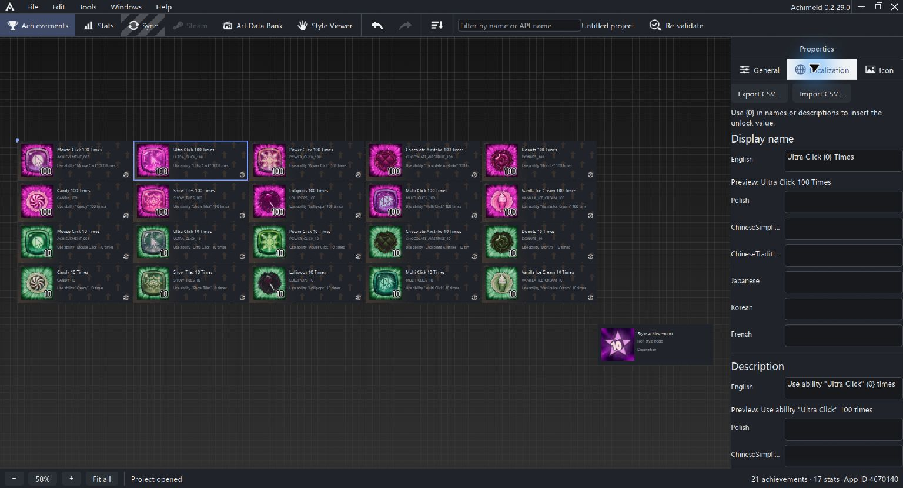

# Achievement localization and translation exchange

An achievement has localized display-name and description templates. Select it and open Localization to edit language fields and preview resolved {0} values.

The application interface language and achievement translation languages are separate settings. Preferences changes the editor's interface; it does not translate your game's achievement text.

## Templates

Keep {0} where the unlock value should appear. The preview substitutes the selected achievement's value while the original template remains editable.

When translating, retain the same number of {0} placeholders as the English source. A translation can move the placeholder within the sentence.

Stats have a localized display name; their inspector omits the achievement description field.

## Export a translator copy

Use Export CSV from Localization, or Tools > Export achievement translations. Export produces a separate handoff file; keep the project-owned localization companion under the application's save workflow.

The handoff has stable ID, Context, English and language columns, with display-name and description rows. Context associates the text with its API name and field.

Give the translator the exported file and ask them to edit only target-language cells. Keep ID, Context, English and headers unchanged.

## Import the result

Use Import CSV or Tools > Import achievement translations. Import validates the whole input before applying a single undoable change.

| Input condition | Result |
| --- | --- |
| Filled valid translation | Updates that cell |
| Blank cell | Keeps the existing translation |
| Omitted or reordered rows | Allowed when their remaining identities are valid |
| Changed English/Context, unknown or duplicate IDs | Rejects the import |
| Broken {0} count | Rejects the import |

Blank cells do not clear existing translations; clear them explicitly inside the editor if that is your intention.

If English text changed after export, export a fresh copy and reconcile the translations against it. Avoid changing row identities to force an old handoff into a new project.

Save the project afterward to persist project/catalog changes. Inspect resolved names and descriptions, including long strings and non-Latin fonts, before reviewing synchronization.

