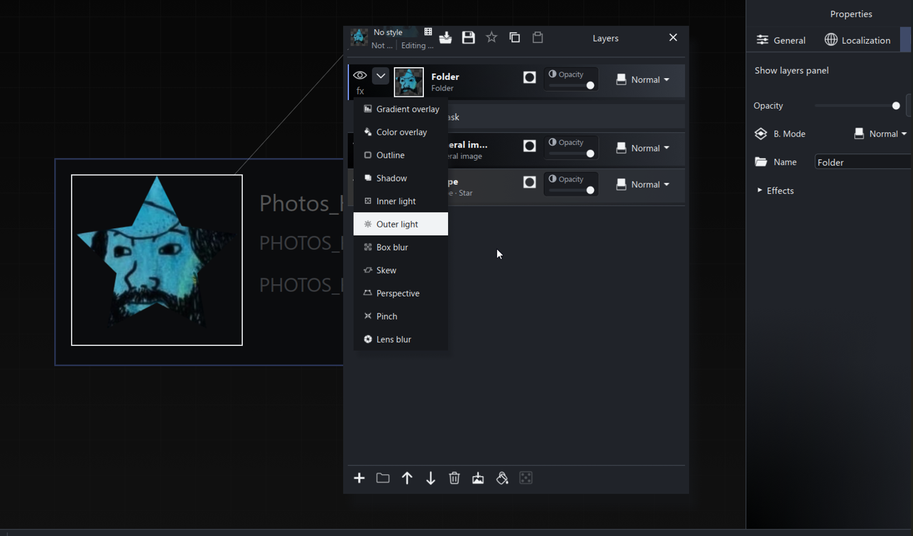

# Masks and reference masks

A mask controls the visibility of its owning artwork, adjustment or folder. Right-click a layer and choose Add mask to create a supported source. The mask appears as an indented entry immediately below its owner.

Click the mask entry or thumbnail to edit its name, grayscale content and transform. Selecting the artwork thumbnail returns to the artwork.

## Example: put artwork in a folder and mask it

A simple way to shape an achievement icon is to put the artwork inside a folder and give the folder a mask. The mask controls the visibility of the folder's combined contents, so several child layers can share one silhouette.

1. Select the achievement and click **Icon** in **Properties**.
2. In **Layers**, click **Create folder**.
3. Drag your **General Image** layer onto the folder. Expand the folder and check that the artwork is indented inside it.
4. Right-click the **folder** and choose **Add mask**. For a star-shaped cutout like the example, choose a **Shape** mask source, select **Star**, and use an opaque white fill with transparent space outside the shape.
5. Select the indented mask entry to adjust its shape, size and position until the artwork is framed as you want it.

The screenshot shows the resulting star-shaped artwork. Its open **fx** menu lists effects you can apply to the folder, such as Outline, Shadow or Outer light. Hovering an effect in that menu does not mean it has been applied.

To reposition the artwork inside the cutout, select the General Image layer and adjust its transform. To change the cutout itself, select the folder's mask entry. Additional artwork placed inside the folder shares the same mask; layers outside the folder remain separate.

Use this technique for a badge, portrait cutout or a group of decorative layers that should share one shape. See [Icon layers](icon-layers.md) for folders and shape controls, and [Icon effects](icon-effects.md) for the effects shown in the menu.

## Read mask coverage

New masks use luminance multiplied by transparency:

| Mask content | Coverage |
| --- | --- |
| Opaque white | Reveals |
| Opaque black | Hides |
| Opaque gray | Partially reveals |
| Transparent | Does not reveal |

Imported mask images are converted to grayscale for composition. The original asset in Art Data Bank retains its colors.

Mask color controls expose gray and alpha. A pasted color is converted to grayscale in this editor. Ordinary artwork retains full color controls.

## Edit replace invert or detach

Right-click the layer or its mask entry to edit, replace, invert, remove or delete the mask.

**Invert mask** reverses coverage. **Remove mask** detaches the source. **Delete mask** removes its source and clears direct users. Choose the action matching whether the mask should remain available.

A folder can own a mask, and a folder used as a mask exposes its contents in the tree. A mask root has no ordinary opacity, blend, effects or nested-mask controls. Procedural presets change its content without adding those controls.

## Alpha masks in older projects

Existing Alpha masks retain their original coverage. Alpha uses source transparency rather than brightness, so opaque black and opaque white can both reveal in an Alpha mask.

Use grayscale mask explicitly converts that legacy behavior to luminance. Loading or merely inspecting an old project does not request that conversion. Older documentation describing different new-mask defaults should not override the current mask workflow.

## Share a mask through a live reference

Use Reference mask to on a mask entry, or Use mask from on a destination layer. Both assign a reference to another layer or folder's mask.

A live reference follows replacement and inversion of the source owner's mask. It does not copy the source's visible artwork, visibility or opacity. The Source layer picker can change the reference.

An unassigned reference, or one whose owner has no mask, fully reveals. Removing a source layer clears the reference. Menus omit choices that would create circular dependencies.

## Copying and styles

Creation, replacement, inversion, referencing, removal and deletion use normal undo/redo. Whole-recipe copies and style application remap internal identities. A copied layer bundle can retain a reference to an existing source; pasting where that source is absent clears the reference for reassignment.

After copying a complex masked composition, inspect its source links before assuming it is independent.

