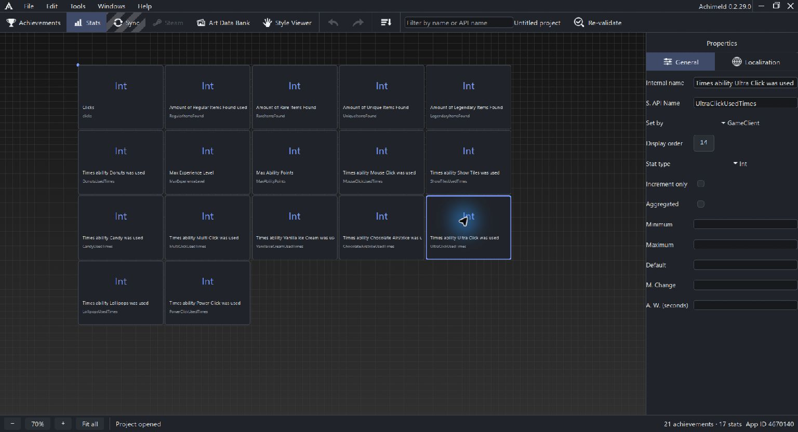

# Stats and achievement progress

Stats define values that your game can report and achievements can follow. Open Stats and select a card to edit its General or Localization properties.

## Identity and type

Internal name labels the stat card on the Stats canvas and updates as you edit it. Steam API name appears beneath it and identifies the game/Steam stat. Localization edits its displayed name for other uses. Display order is separate from the card's canvas position.

| Type | Intended value |
| --- | --- |
| Int | Whole-number counters, totals or levels |
| Float | Fractional quantities |
| AverageRate | Rate measurements with a time window |

Set by selects GameClient, GameServer or OfficialGameServer as the configured reporting authority. These definitions do not implement the game's reporting calls.

## Numeric configuration

| Field | Meaning |
| --- | --- |
| Minimum / Maximum | Configured lower/upper values |
| Default | Initial/default value |
| Maximum change | Limit associated with a reported change |
| Average-rate window (seconds) | Time window for average-rate configuration |
| Increment only | Configures the stat as increasing only |
| Aggregated | Includes the stat's aggregation setting |

Optional numeric fields can be unset; a blank value is different from an explicit zero. Minimum must not exceed Maximum, and Default must fit any configured bounds. Average-rate and change constraints should match your reporting workflow.

Do not assume that changing a local field changes existing player values. Game behavior, Steam configuration and local definitions are separate parts of the integration.

## Link an achievement

Create or select the stat, then return to achievement General settings. Choose the stat-linked mode, select the progress stat and set its unlock threshold. The selector lists API names alphabetically in screen-fitting columns; scroll across when more than three columns are needed.

An Int link uses an integer unlock kind; other types use float. Check linked achievements when changing a stat's type or range. The automation interface rejects inconsistent linked thresholds rather than silently repairing them.

In the example, UltraClickUsedTimes is Int and the achievement threshold is 100. Both the name's {0} template and a linked icon Text layer can use that threshold.

## Organize the canvas

Right-click empty canvas for Create stat. Use the filter by name/API name, zoom controls and Fit all to navigate. Duplicate and Delete act on the current selection when the canvas owns focus.

Sort opens grid alignment: items per row/column, row/column fill, all/selected scope and stat-activation options where applicable. Alignment moves cards; it does not rename stat identifiers. Selected-only alignment avoids stationary cards. An empty selection does not align anything.

Save after configuring definitions. Use [Sync](sync.md) to review changes with Steam.

