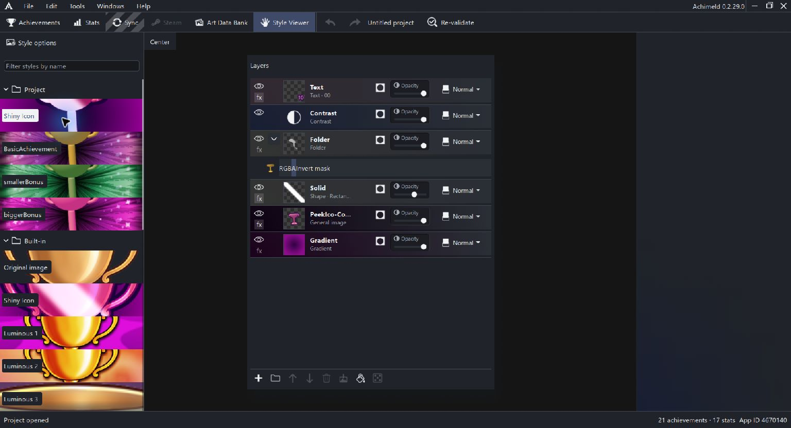

# Styles and Style Viewer

A style is a reusable icon recipe. General Image slots and value-linked text let the same recipe use different achievement artwork and numbers. Read [Icon editor concepts](icon-editor.md) before editing shared styles.

## Apply save or edit

The style banner in achievement General settings selects project styles. No style can coexist with a complete individual recipe; it does not mean the icon is empty.

Saving the current icon as a project style assigns the new style and offers Stay in icon edit mode or Edit style. The latter enables shared-style editing. Affect style changes the project recipe and matching icons together in one undoable transaction. Check this mode before making an edit intended for only one achievement.

Style helper nodes are local composition tools excluded from Steam. A linked helper edits its explicitly linked project style. Clearing its Linked style keeps the current recipe. Independent helpers are not inferred to be linked solely because their recipes match.

## Browse Style Viewer

Style Viewer is a main view with Project and Built-in folders. Search by name. Built-ins are read-only; duplicate one into the project to edit it. Project styles support rename and deletion through context actions.

Pan and wheel-zoom the main preview, from 10 to 1600 percent. Center resets its framing. This preview camera is separate from the achievement canvas.

The existing screenshot shows the banners and a retained stack; a selected-style preview is still a separate capture task.

## Style options and preview inputs

| Setting | Purpose |
| --- | --- |
| Banner height | 48-240 points, default 64 |
| Resolution | 64, 128, 256 or 512 pixels; default 512 |
| Unlock value | Decimal preview input, default 10 |
| General image IDs 0-2 | Supply artwork to recipe slots |
| Miniature Art Data Bank | Select All, General, Icons or Atlases |
| Clear | Clears only the chosen preview input |
| Clone all built-ins | Makes independent project copies without applying them to icons |

Preview inputs save in project metadata and support undo without replacing achievement artwork. Selecting a preview image does not apply a style to an achievement.

Project style edits update using icons and explicitly linked nodes. Deletion offers preserving their current appearance while breaking the link, or adopting a remaining project style. Cancel changes nothing; undo restores the style and affected icons.

## Portable style JSON

Style options > Load styles and Save styles use .json files of layer recipes. The import limit is 16 MiB and 128 styles, validated before additive import. Imported identities are independent. Export requires an unused destination.

General Image IDs make a recipe portable. Direct image/atlas references require matching artwork in the receiving project's bank; these files do not carry the entire source project or arbitrary file paths.

Legacy .achv collections remain available through supported collection/MCP workflows. They are distinct from the main Style Viewer's JSON load/save controls.

After importing a style, supply every required General Image slot before applying it. Inspect masks, text links and random-seed variation in the result.

