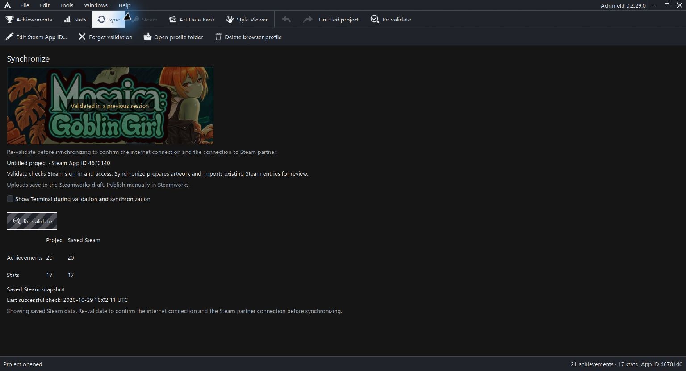

# Synchronization review and recovery

Sync connects a saved local project with a Steamworks destination. Validate checks sign-in and access. Synchronize prepares fresh information, artwork and a review.

Uploads save to a Steamworks draft. Publishing remains a manual Steamworks step.

## Destination and connection

Check the project name and Steam App ID. Edit Steam App ID changes the intended association. Save the project before validating; an unsaved project receives guidance to save first.

Open achievements and Open stats beside the validation or synchronization action open the selected project's pages in the dedicated Steam browser. Close that browser window when finished. These shortcuts do not validate the connection or change the project.

A banner marked Validated in a previous session and a saved timestamp describe cached information. Re-validate to confirm the current connection before synchronizing. Matching counts alone do not establish matching fields or icons.

Validation checks Steam sign-in before reading the game banner. If the banner is unavailable, validation continues without replacing the saved banner. A worker error during banner retrieval stops validation; retry with a build that includes the banner read fix.

Forget validation clears saved validation/snapshot/banner data after its confirmation while retaining authored entries and used artwork. Save persists that local edit.

Open profile folder and Delete browser profile manage the dedicated Steam browser profile. Deleting it removes saved sign-in, not your Steam account or project.

## Review differences

The square review modal identifies the validated App ID and lists every proposed definition or icon change before Steamworks is updated. Artwork-only edits appear as Icon changes. Filter by API name and scroll through the full list without page breaks.

| State | What it asks you to inspect |
| --- | --- |
| Only in project | A local definition absent from the read |
| Only on Steam | A remote entry needing an import decision |
| Project changed | Local changes relative to the baseline |
| Steam changed | Remote changes relative to the baseline |
| Review both versions | Conflicting changes |
| Up to date | No current difference; omitted from the differences list |
| Artwork unavailable | Repair its source before an icon upload |
| Renamed on Steam | Import preserves the old entry as Retired |

Use project, Use Steam and Leave unchanged appear according to the entry and review state. Choose Leave unchanged to unselect a proposed upload or import; you can select it again before synchronizing. These choices do not delete remote entries. Do not assume every row offers all choices.

Expand field differences and inspect the actual values. An import choice can change the associated icon choice so incompatible import/upload combinations are not retained.

## Apply selected changes

Check the destination, field choices and selected-change count. Planned Steam draft actions and editable choices share one scrolling modal. A thin bar counts down five seconds after a plan is ready, then synchronization starts automatically. Press Stop to pause the countdown and edit choices. Start 5 s begins a new countdown; Synchronize now submits immediately; Cancel discards the review. Another notice pauses the countdown so it cannot submit behind a blocking prompt. The review token and Steam App ID bind the operation to the captured project and destination.

An MCP client can perform the same supervised workflow for a saved project. It validates first, prepares a fresh review, then supplies the review token and an explicit action for every row. The client can poll the current review, activity and errors, or cancel active work. See [Local editor automation](automation.md) for the tool sequence. Steamworks publication remains manual.

The review uses a frozen project snapshot and caches achieved and unachieved icon PNG bytes before showing choices. Editing and ordinary Save remain available. Later edits are retained for the next synchronization, and the current upload uses the captured artwork. A conflicting completion retains local edits and asks for a fresh review.

Progress shows stage and elapsed time in a movable nonmodal window. Cancel uses the active operation's cancellation path. Project replacement, Save As, and Steam App ID changes remain guarded while the snapshot is active.

Browser cleanup may continue briefly after validation or synchronization reports completion. Achimeld keeps a new Steam worker gated until the previous owned browser Job reports no active processes; changing process membership during cleanup does not require a manual retry when that Job check can finish in the background.

Exit during an active synchronization cancels the frozen operation and continues to the normal Save/Discard/Cancel choice for unsaved local edits. A visible dialog does not pause synchronization cancellation or completion. After an interrupted draft write, validate and prepare a fresh review to reconcile Steam.

## Interrupted work

An interruption can leave uncertain remote draft results. Reconcile using a fresh Steam read and review the remaining differences. Do not blindly repeat the previous plan.

When Cancel interrupts the Steam connection, a read or the read-only plan check before any draft step starts, Achimeld reports cancellation even if the worker connection closes before it replies. Validate again before preparing a new review. Once a draft step has started, use a fresh review to establish which changes reached Steam.

Steam icon image delivery can lag behind a successful draft upload. Achimeld records the downloaded Steam image hash before the upload, then retries fresh saved-configuration reads and image downloads for a short bounded period. A new image hash must appear for the exact achievement icon. It does not repeat a possibly successful upload automatically.

The reviewed upload captures 256 by 256 pixel icon PNGs even if the project's atlas export size is larger. A full Steam read must report the same new hash before the step completes. A stale editor thumbnail does not determine whether the upload succeeded.

If the image hash stays unchanged, Achimeld reports an uncertain stale result and requires a fresh Steam review. A changed hash establishes new saved bytes for the selected record; it does not by itself prove the image depicts the intended art, so inspect the public preview when exact visual content matters.

For a prepared review, the local MCP connection can return the public Steam image links and content hashes for one achievement. This supports checking the exact draft art after an uncertain upload without opening an authenticated Steamworks page.

Local edits remain dirty when appropriate after a merge. Conflicting changes preserve local work and require a fresh review. Read completion/error guidance and use [Troubleshooting](troubleshooting.md) for diagnostics.

Fresh live validation, draft writes and interruption recovery still require controlled acceptance before these draft instructions can be marked fully runtime verified.

